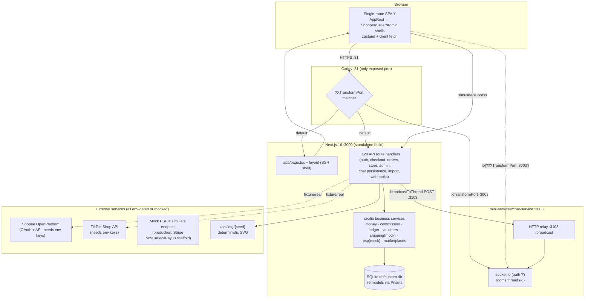
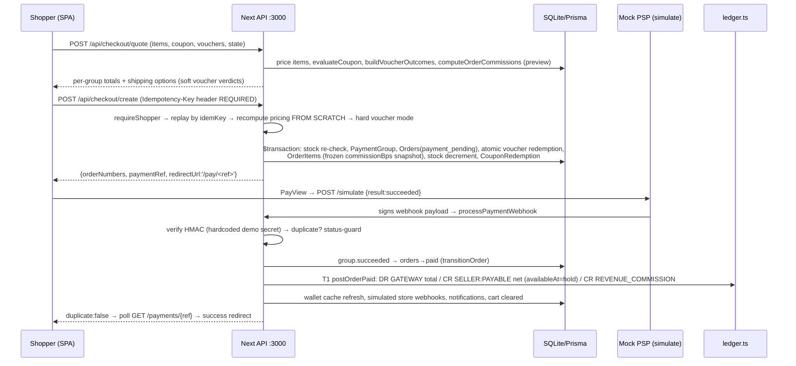
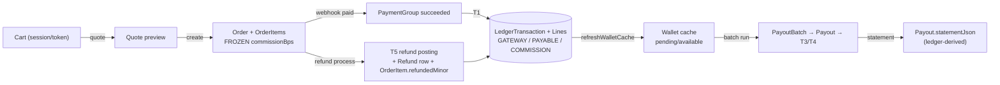

# Blueprint Support 01 — Architecture & Repository Map (Parts B & C)

Evidence labels: **[V]** verified, **[I]** inferred, **[P]** partial, **[M]** missing, **[U]** unverified. All paths relative to repo root `/home/z/my-project`.

---

## PART B — Complete repository and file map

### B.1 Application shape (plain English first)

NOMOFEE is a **single Next.js 16 application** (App Router, Turbopack dev) that contains three logically separate products — a shopper marketplace, a seller portal and an admin back office — mounted as **client-side view machines on the single user-visible route `/`** (`src/app/page.tsx:1-5` → `src/components/app-root.tsx:14-46`). All server logic lives in ~120 API route handlers under `src/app/api/**`; there are **no server actions** (zero `'use server'` matches) and no RSC data fetching. A second, deliberately tiny process (`mini-services/chat-service`, socket.io on :3003) relays chat messages. Persistence is one SQLite file via Prisma. A Caddy gateway (:81) is the only externally exposed port and forwards `?XTransformPort=` requests to internal services. [V]

The codebase grew task-by-task under an orchestrator/worklog regime (Tasks 1–19 per `worklog.md`); layering is clean in the API layer but the frontend contains several very large multi-concern client files (see hotspots in Support 10).

### B.2 Directory inventory by functional responsibility

| Path | Responsibility | Notes |
|---|---|---|
| `src/app/` | App Router root | `layout.tsx` (static metadata, fonts), `page.tsx` (only route → `<AppRoot/>`), `sitemap.ts` (force-dynamic; emits `/`, `/?sf={slug}`, `/?sf&sp=`), `globals.css` (Tailwind v4 `@import`, teal brand remap, inert `.dark` block) [V] |
| `src/app/api/**` | **All backend logic** (route handlers) | Modules: `auth`, `me`, `cart`, `checkout`, `orders`, `market`, `sf`, `store`, `admin`, `chat`, `import`, `img`, `shipping/tick`, `claim`, `campaigns`, `webhooks/payments`, `stores/[slug]/follow`, `health`. Shared helpers: `api/admin/_helpers.ts`, `api/_shared/product-card.ts`, `api/checkout/{pricing,owner}.ts`, `api/cart/cart.ts`, `api/webhooks/payments/process.ts` [V] |
| `src/components/` | Three client portals | `app-root.tsx` (keystone switch), `portal-fab.tsx` (demo surface switcher), `shopper/*` (11 files incl. 2,569-line `checkout.tsx`), `seller/*` (21 files), `admin/*` (29 files), `ui/*` (49 shadcn components, 20 unused) [V] |
| `src/lib/` | Business services & shared policy | `money.ts` (POLICY P1 money/rate math), `commission.ts` (M09 engine), `ledger.ts` (double-entry + wallet cache), `psp.ts` (mock PSP + Option-B scaffold), `vouchers.ts`, `shipping.ts` (mock courier), `auth.ts`/`password.ts`/`secretbox.ts` (identity/crypto), `api.ts` (envelope/audit/notify/webhook-sim/transitionOrder), `commission-export.ts` (snapshot/CSV), `marketplaces/*` (Shopee/TikTok/fixture connectors), `import/*` (runner/normalise/summary), `chat.ts` (relay client), `campaigns.ts`, `membership.ts`, `feature-flags.ts`, `json.ts`, `seo.ts`, `sections.ts` (15 builder section types), `store-lifecycle.ts`, `shopper-merge.ts`, `notify-shopper.ts` (dead), `chat-quick-replies.ts`, `app-store.ts`, `session-client.ts`, `db.ts` (Prisma singleton) [V] |
| `src/hooks/` | `use-mobile`, `use-toast` | [V] |
| `prisma/` | `schema.prisma` (1,215 lines, 76 models) + 4 seed scripts | `seed.ts` (destructive full demo), `seed-me.ts` (shopper wallet/vouchers), `seed-vouchers.ts`, `seed-campaigns.ts` [V] |
| `db/` | `custom.db` (SQLite, 1,261,568 B, journal_mode=delete) + `db/backup/fin-migration-2026-10-18T08-25-00-334Z.json` | M-FIN-1 audit backup; both git-tracked (security finding F-02) [V] |
| `scripts/` | One-off operational scripts | `migrate-money-bps.ts` (FROZEN, must-not-rerun), `verify-migration-freeze.ts` (read-only re-run guard proof), `rollback-money-bps.ts` (emergency), `fin-tests.ts` (56 unit tests), `fin-reconcile.ts` (25 live-DB invariants), `fix-payout-statements.ts`, `rebrand-db.ts` (SHOPMESH→NOMOFEE), `e2e-fin-issues.sh` [V] |
| `mini-services/chat-service/` | Independent bun project, socket.io hub | `index.ts` (:3003 public socket + :3103 internal HTTP relay), own `package.json`/`bun.lock`; started via `.zscripts/dev.sh` scan with `bun --hot` [V] |
| `tests/` | Sandbox deploy-infra shell scripts | `database-runtime-build.sh`, `python-runtime-{container,build}.sh` — **not app tests** [V] |
| `docs/` | Prior documentation | `codebase-inventory.md` (stale, pre-Task-13), `handover.md` (stale, post-Task-12), `implementation-plan.md` (import feature planning), `recovery/RECOVERY.md` (historical rebuild brief), `research-raw/*` (Shopee/TikTok API research artifacts) [V] |
| `upload/` | Original platform blueprints (PART0–PART6) the code was built from | Intent documents, not runtime evidence [V] |
| `public/` | Static assets | `products/*` (30 PNGs), `stores/*`, `banners/*`, `logo.svg`, `robots.txt`; runtime uploads land in `public/uploads/{storeId}/` (import image copier) [V] |
| `examples/websocket/` | Socket.io reference demo | Not imported by the app [V] |
| `agent-ctx/`, `tool-results/` | Agent working notes & screenshots | Process artifacts [V] |
| Config files | `next.config.ts`, `tsconfig.json`, `tailwind.config.ts`, `postcss.config.mjs`, `eslint.config.mjs`, `components.json`, `Caddyfile`, `.env` (DATABASE_URL only), `.gitignore` | See Support 09 §P for contents/implications [V] |
| **Missing infrastructure** | No `prisma/migrations/`, no CI/CD (`.github/`, Dockerfile, vercel.json), no middleware.ts, no i18n routing, no Docker | [M] |

### B.3 Legacy / suspicious files

- **Dead modules**: `src/lib/marketplaces/util.ts` (0 importers), `src/lib/marketplaces/callback.ts` (logic re-implemented inline in `api/auth/callback/[platform]/route.ts:10-55` — drift risk). [V]
- **Dead exports**: `ledger.buildPayoutStatement` (superseded), `money.commissionOfBps`, `auth.requireAdminRole`, `secretbox.safeEqual`, `notify-shopper.notifyShopperShipped` (duplicate of `shipping.pushBuyerNotificationForShipped`), `commission.snapshotToJson`, `store-lifecycle.isImportTerminal`. [V]
- **Unwired endpoints** (no frontend caller): `GET /api/store/payouts`, `/api/admin/announcements*`, `/api/admin/webhook-deliveries(+replay)`, `POST /api/shipping/tick`. One **broken caller**: `admin/stores.tsx:64` POSTs `/api/admin/domains/{id}/verify` — route does not exist (404). [V]
- **Rebrand residue** (SHOPMESH→NOMOFEE): `demo.shopmesh.fixture` host (`shopper/generate.tsx:142`), `ShopMeshImport` UA (`marketplaces/util.ts:8`), `shopmesh-dev-key` seed for secretbox dev fallback (`secretbox.ts:21`), "SM-100017" lookup copy (`checkout.tsx:2522,2537`). [V]

---

## PART C — System architecture and dependency map

### C.1 High-level system architecture

### C.2 Communication paths (verified)

1. **Browser → frontend**: one SSR'd shell page; everything after load is client state machines. Deep links honoured: `?sf={store}&sp={product}` (SEO/sitemap contract, `shopper-shell.tsx:163-170`) and `?claim_job=&claim_token=` (import claim, :153-162). [V]
2. **Frontend → backend**: `fetch('/api/…')` with per-portal helpers — shopper `fetchJson/postJson` attaches **device headers only** (`X-Cart-Token`, `X-Shopper-Token`; cookie does session) (`shopper/ui-bits.tsx:214-276`); seller `withAuth` adds `Authorization: Bearer` (`seller/ui-bits.tsx:98-126`); admin `use-api.ts` adds Bearer. Session validation is server-side dual-channel: Bearer header **or** `sm_session` cookie (`src/lib/auth.ts:53-76`). [V]
3. **Backend → services**: route handlers import `src/lib` directly; `src/lib` imports `db.ts` (Prisma). No service layer between routes and lib; no DI. [V]
4. **Backend → database**: Prisma Client (singleton, global-cached in dev, `db.ts:13`), SQLite file, journal_mode=delete, foreign_keys enforced by Prisma per-session. `$transaction` used in only **7 route files** (checkout/create, auth/register, claim/bind, checkout/addresses ×2, store/inventory/adjust, store/collections/[id]/products). [V]
5. **Realtime**: Next API persists `ChatMessage` then POSTs `http://127.0.0.1:3103/broadcast {room:"thread:<id>", event:"chat:message"}` (`src/lib/chat.ts:7-20`, 1.5s timeout, failure non-fatal); hub emits to room. Clients `io("/?XTransformPort=3003")`. **No auth on socket join** (rooms are client-claimable; risk R-RT1 in Support 07). [V]
6. **Asynchronous processing**: **none exists**. Simulated workers: `dispatchStoreWebhooks` writes success rows without network calls (`src/lib/api.ts:127-144`); notifications are inline `NotificationLog` rows (`api.ts:113-124`); mock shipments advance lazily on buyer order reads (45s guard, `me/orders/route.ts:146`) or via uncalled `POST /api/shipping/tick`. No cron/queue/BullMQ anywhere. [V]
7. **File/image storage**: local `public/` only; import copier writes `public/uploads/{storeId}/{sha256-16}.{ext}` with SSRF-guarded fetch (`src/lib/import/runner.ts:52-77`); no S3/OSS. Image "generation" = deterministic SVG service `/api/img/{seed}` + client-side seed reshuffling. [V]
8. **Caching**: 60s active-campaign memo on `globalThis` (`src/lib/campaigns.ts:462-524`), wallet denormalised cache refreshed **on write** from ledger truth (`src/lib/ledger.ts:136-149`), per-process import-summary Map, device-token memo, shipping-tick 1.5s throttle. [V]
9. **Observability**: `/api/health` (public; counts + `runLedgerInvariants()`), `/api/admin/system/health` (admin; same + last 5 audit rows; 30s UI poller), `AdminAuditLog`+`ActivityLog` dual-write via `auditAdmin` (45 admin route files), `PaymentWebhookLog` for every webhook delivery. No structured logger (11 `console.*` total), no error reporting, no metrics/tracing. [V]

### C.3 Request lifecycle (checkout example)

Note the flagged hazard: the webhook success path is **not transactional** and the duplicate guard is a status check made **before** the ledger posting — see Support 06 §7 and finding FIN-02. [V]

### C.4 Module boundaries and bypasses

- Intended boundary "UI → API → lib → Prisma" holds; no frontend talks to SQLite, no API route bypasses lib for money math **in the authoritative path** (client totals are display-only and re-derived server-side — `checkout/create/route.ts:108-114` "never trust client numbers"). [V]
- Boundary exceptions: (1) `Order.commissionBps` snapshot logic lives in `checkout/create` + `webhooks/process` + `refunds/process` consuming `commission.ts` — consistent single engine; (2) seller dashboard earnings derive from frozen OrderItem snapshots **on read** while admin analytics derive from ledger lines — two deliberate but divergent read models (Support 06 §5); (3) status labels & order-status arrays duplicated ≥5× across client files (no central state machine — `transitionOrder` validates nothing). [V]

### C.5 Data-flow diagram (core write paths)

