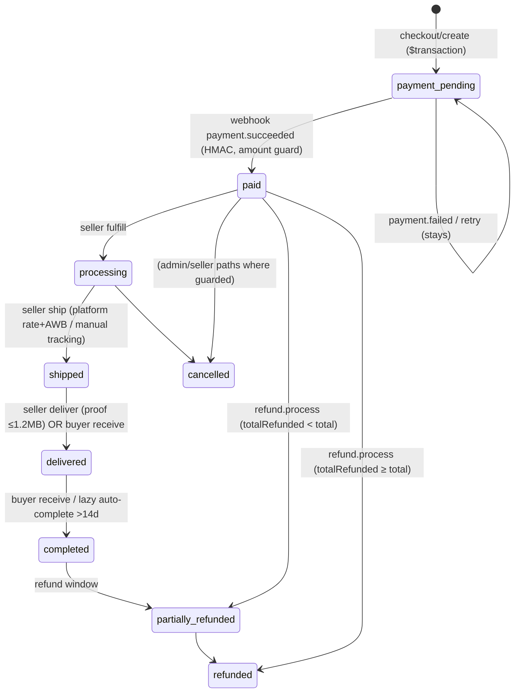
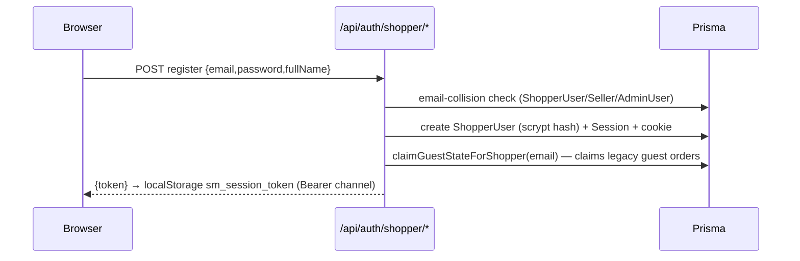
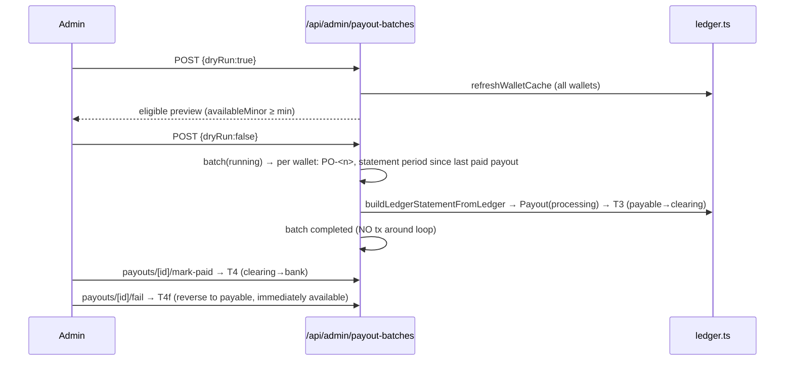

# Blueprint Support 05 — Order Lifecycle, Marketplace Architecture & System Flows (Parts G, I, S)

## PART G — E-commerce domain and order lifecycle

### G.1 Lifecycle diagram (implemented statuses)

### G.2 Status transition authority table

| Transition | Trigger code | Authority | DB fields written | Financial/inventory effect |
|---|---|---|---|---|
| → `payment_pending` | `checkout/create/route.ts:222-246` (in `$transaction`) | shopper (session) | Order.status, idemKey, paymentGroupId, voucherId | stock decrement + InventoryLog + salesCount; voucher AVAILABLE→USED atomic; CouponRedemption |
| → `paid` | `webhooks/payments/process.ts:140-146,274+` via `transitionOrder` | verified webhook (HMAC) | status, paidAt | **T1 ledger**; wallet credit (hold); cart cleared; simulated store webhooks; notifications |
| → `processing` | `store/orders/[id]/fulfill` | seller (store-scoped) | status, fulfilledAt, history | — |
| → `shipped` | `store/orders/[id]/ship` | seller | status, shippedAt; Shipment+events, awbNumber | buyer notification (`shipping.ts:313-329`) |
| → `delivered` | `store/orders/[id]/deliver` (seller, proof) or `me/orders/[n]/receive` (buyer) | seller XOR buyer | status, deliveredAt; Shipment POD | — |
| → `completed` | `me/orders/[n]/receive` or **lazy sweep** `me/orders/route.ts:107-113` (delivered >14d, 60s throttle) | buyer / system | status, completedAt | — |
| → `partially_refunded` / `refunded` | `admin/refunds/[id]/process:55-67` | admin (`refunds.manage`) | status; Refund.processed; OrderItem.refundedMinor; paymentIntent→refunded | **T5** (seller share + commission reversal / gateway); restock **full item qty** |
| → `cancelled` | guarded per-route (unpaid only in shopper paths) | per-route guards | status, cancelledAt | none observed (no auto stock restore found) |

**Central state machine: none.** `transitionOrder` (`lib/api.ts:147-167`) performs read→update→history with **no from-status legality validation**; legality is enforced by per-route guards using **duplicated status arrays** (≥5 sites — Support 10 §4). Concurrent transitions are racy (check-then-act). [V]

### G.3 Stage-by-stage lifecycle (implemented vs missing)

| Stage | Status | Evidence |
|---|---|---|
| Product creation/publishing | **Implemented** | seller products CRUD + admin moderation (pending_review→active) |
| Pricing/variants | **Implemented** | variant priceMinor; compareAtPrice not surfaced in checkout math |
| Stock reservation | **Deduct-at-checkout** (not reservation) | create `$transaction` re-check + decrement; two-phase reservation absent [V] |
| Cart | **Implemented** (account-scoped; guest read-only) | `cart/cart.ts:1-6` |
| Checkout validation | **Implemented** (server recompute, hard voucher mode, shipping assert) | `create/route.ts:102-165` |
| Shipping calculation | **Mocked but consistent** | 2 rates (standard RM8 free≥RM100; express RM15 non-East-MY) `pricing.ts:12-21` |
| Discounts/vouchers | **Implemented** (coupon single-group; voucher per-store atomic redemption) | `pricing.ts:313-330`, `create:251-269` |
| Payment initiation | **Implemented** (mock PSP; redirectUrl `/pay/{ref}`; 30-min expiry) | `create:167-213` |
| Payment confirmation/webhook | **Implemented** (HMAC demo secret; status-idempotent) | `process.ts` (hazards in Support 06) |
| Order creation | **Implemented** (multi-store groups, frozen commission) | |
| Seller processing | **Implemented** (fulfill→ship→deliver + label SVG + POD) | `store/orders/*`, `lib/shipping.ts` |
| Delivery confirmation | **Implemented** (buyer receive + lazy auto-complete) | |
| Cancellation | **Partial** (unpaid paths only; no auto stock restore) | per-route guards |
| Partial/full refunds | **Implemented** (admin-processed; first-item attribution heuristic) | Support 06 §6 |
| Returns/exchanges | **Dispute row only** — no exchange workflow | `me/orders/[n]/return-request` [V] |
| Notifications | **Implemented as DB rows** (no email/SMS dispatch) | `lib/api.ts:113-124` |
| Seller earnings/settlement | **Implemented** (frozen snapshots + ledger truth + payout batches) | Support 06 |
| Reconciliation | **Scripts, not runtime** | `scripts/fin-reconcile.ts` A–M |

### G.4 Double-execution / race inventory (order domain)

1. Webhook duplicate ⇒ status-guard no-op (safe single-threaded; TOCTOU under concurrency — FIN-02). 2. Stock check-then-act inside tx without conditional decrement (`create:296`). 3. Coupon `timesUsed` re-check absent inside tx. 4. Voucher redemption race-safe (guarded `updateMany`). 5. `nextOrderNumber` outside tx ⇒ number gaps on rollback. 6. `transitionOrder` concurrent double-fire possible. 7. Refund process + payout mark-paid check-then-act. All [V] with runtime behaviour untested ([I] for actual exploitability under SQLite single-writer).

---

## PART I — Multi-vendor and marketplace architecture

| Capability | Status | Evidence |
|---|---|---|
| Vendor registration & approval | **Implemented**: seller register (tx: seller+draft store+wallet+4 pages) → onboarding wizard (identity/KYC/bank) → submit → `pending_review` → admin approve/reject/suspend/activate/terminate | `auth/register`, `store/onboarding`, `admin/sellers/*` [V] |
| Vendor identity & ownership | Store 1-0..1 Seller; all store queries scoped by `storeId`; **zero IDOR found in request paths** (Support 07 §2) | [V] |
| Store creation/configuration | Store settings/theme/SEO/domains(simulated verify)/collections | [V] |
| Storefront claiming (imports) | **Implemented**: public import job (fixture platform fully working; Shopee/TikTok real network clients gated on env) → provenance fields → single-use SHA-256 claim token (14-day) → seller binds job → guarded tx retires placeholder & binds | `import/*`, `claim/bind`, `StoreClaim.tokenHash @unique` [V] |
| Import pipeline internals | URL resolve is **parse-only** (no fetch of pasted URL); `assertPublicHost` blocks private ranges; image copier SSRF-guarded **per redirect hop** (`redirect:"manual"` + re-validation + 3-hop cap — F-06 resolved 2025-10-18); normaliser regex-sanitises HTML; duplicate detection via `@@unique([storeId,sourcePlatform,sourceProductId])`; errors persisted on ImportJob; ownership deferred to claim | `import/resolver.ts:25-79`, `runner.ts` [V] |
| Vendor staff/roles | **Not found** (single seller login; `ApiKey` scopes scaffold exists) | [M] |
| Multi-vendor carts & orders | **Implemented**: one cart, per-store groups at checkout, one PaymentGroup charge covers N orders, per-order commission + ledger | `pricing.ts:228-330`, `create/route.ts` [V] |
| Order splitting & fulfilment | Per-store order fulfilment independent | [V] |
| Commission rules | Global bps → product → category-ancestor → seller; **admin CommissionOverride table is dead config** (FIN-01); fee holidays replace rate (clamped) | `commission.ts:113-193` [V] |
| Payment collection & allocation | Option-B split model (PSP collects; platform fee = commission); mock PSP; ledger mirror | `psp.ts:1-36` [V] |
| Seller balances & payouts | Ledger-truth wallets; hold days; payout batches (manual_csv); statements ledger-derived | [V] |
| Vendor disputes & refunds | Dispute lifecycle (open→under_review→resolved/rejected, no money movement); seller-initiated refunds admin-processed | [V] |
| Vendor suspension | Seller.status suspended/terminated blocks login (403) & portal screens | `auth/login:32`, `seller-shell` [V] |
| Data isolation | App-level scoping only (no RLS possible on SQLite); admin override is by design (RBAC caps) | [V] |
| Cross-vendor access attempt paths | Store routes 100% scoped; shopper routes owner-scoped; portal escalation blocked at userType checks | Support 07 §2 [V] |

## PART S — System flows (sequence diagrams for critical flows)

### S.1 Customer registration & login

Login mirrors register minus creation; suspended ⇒ 403. [V]

### S.2 Discovery → variant selection
Market home/PDP fetch public `market/sf` APIs → variant picker bounded by stock → activity tracking (VIEWED/LIKE upsert) → recommendations feed from recent 30 activities. [V]

### S.3 Add to cart → checkout
See C.3 sequence diagram (Support 01) and E.3 trace — quote (soft voucher verdicts) → create (hard mode, tx, frozen commission) → pay view → simulate/webhook → paid + T1. Crosses transaction boundaries at: create (`$transaction`), webhook (NO tx), refund (NO tx), payout batch (NO tx). [V]

### S.4 Payment creation & confirmation
PaymentGroup = one PSP session (`ref_`+16hex, 30-min expiry) → public status polling → simulate signs webhook server-side → `processPaymentWebhook` (log-first, HMAC, amount guard, status idempotency) → T1 → notifications → cart clear. Payment failure keeps orders payment_pending; retry re-opens. [V]

### S.5 Order creation & seller fulfilment
Per-store orders created in one tx → seller fulfill → ship (platform: quote+rateId→AWB SVG "MOCK LABEL — DEMO USE ONLY"; manual: provider+tracking) → deliver (proof data-URL ≤1.2MB) → buyer receive or lazy auto-complete (>14d, 60s throttle). Mock shipments advance lazily on buyer order reads (45s guard). [V]

### S.6 Commission calculation & seller payout

Commission itself is computed once at checkout/create from the resolution chain and **frozen** per line; refunds reverse from frozen bps; exports/analytics aggregate stored data (never recomputed against current rules). [V]

### S.7 Refund / cancellation
Shopper Dispute → seller Refund(requested) → admin approve/reject → process (T5 + status + restock). See E.5. [V]

### S.8 Vendor onboarding & storefront management
Register (tx) → onboarding wizard (settings/theme → KYC docs → bank → submit) → admin review (approve/reject + notes + KYC doc verdicts + bank verify) → active → full portal (products, builder draft/publish/revert, domains simulated, webhooks simulated, integrations KV). [V]

### S.9 Catalogue import & claim
resolve (parse-only, platform detect + authStatus) → POST jobs (public; real platforms ⇒ `awaiting_authorisation` until OAuth env keys; fixture works) → runner: authorise → fetch (connector) → normalise (HTML sanitise, price→minor, variant map) → items + summary (cached) → trackingToken polling (8s UI) → claim token (hashed, single-use, 14d) → seller claim/bind (guarded tx, retires placeholder store). [V]

### S.10 Chat (realtime)
Shopper POST thread/message → persist → `broadcastToThread` POST hub :3103 → hub emits `chat:message` to room → both clients dedupe by id + mark read; hub failure non-fatal (poll fallback). Auto-reply scaffold dormant. [V]
