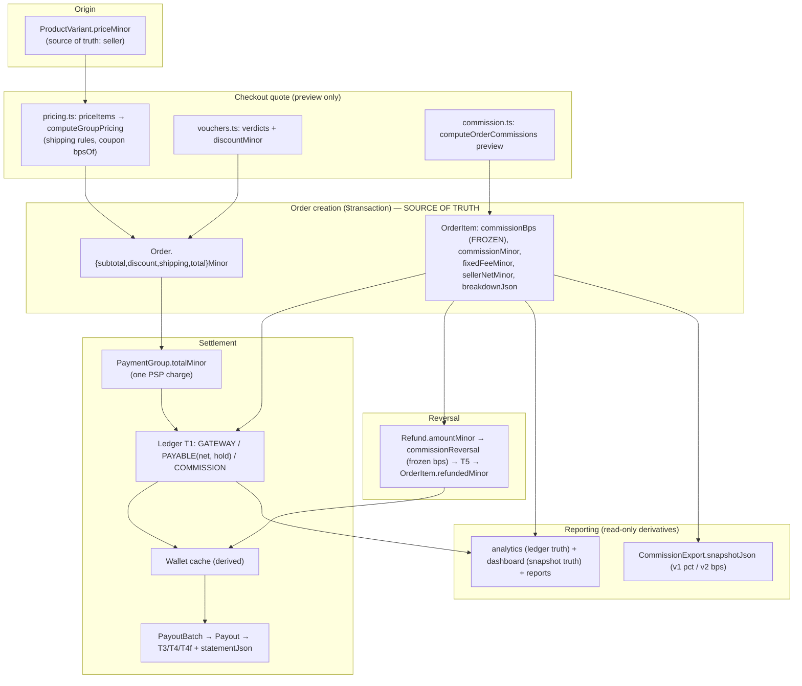

# Blueprint Support 06 — Financial Engine & Money Precision (Part H) + Financial Integrity Map (Part V)

The most audit-critical document in this blueprint. Labels [V]/[I]/[P]. Key claims cross-verified by direct reads of `src/lib/money.ts`, `src/lib/commission.ts`, `src/lib/psp.ts`, `prisma/schema.prisma` and the live DB snapshot (Support 04 §F.1).

## H.1 Money & rate primitives — POLICY P1 (`src/lib/money.ts:1-118`)

One documented policy governs every module [V]:

1. **Storage**: integer minor units (sen) for money; integer bps for rates (`BPS_DENOM = 10_000`, `money.ts:53`; derived `BPS_PER_PERCENT_POINT`, `BPS_DECIMALS` — scale raise to 1,000,000 is a documented one-line change). No FLOAT/DOUBLE money columns remain (only `Product.ratingAvg Float`, non-money, and `FinMigrationBackup.oldValue Float`, audit anchor).
2. **Rounding**: exactly ONE rounding point per payable amount — **ROUND_HALF_UP away from zero on exact integer arithmetic** (`divHalfUp`/`mulDivRoundHalfUp` with automatic BigInt beyond `MAX_SAFE_INTEGER/2`); never `Math.round(a/b)`, never `toFixed` on money.
3. **Splits**: largest-remainder allocation (`allocateProportionally`) — Σ(parts) ≡ amount exactly, deterministic tie-break.
4. **Nets**: pure integer add/sub of already-rounded amounts.
5. **Overflow**: BigInt fallback paths; `assertSafeInt` throws `MONEY_INT_VIOLATION`.
6. **Display**: formatting divides for presentation only, never feeds back.
7. **Input**: digit-exact parsing (`parsePercentToBps` "8.35"→835; >2dp **rejected**, not rounded); legacy shim `percentToBpsExact` flags lossy values.

**Commission engine** (`src/lib/commission.ts`): settings singleton (`defaultBps` 800, `appliesToShipping` false, `basePriceRule paid_price`, `fixedFeeMinor`, `minCommissionMinor`, `payoutHoldDays` 7, hold rules) → `resolveRate` chain **CommissionOverride table row → product → nearest category ancestor (cycle-guarded) → seller → global**, then an active fee holiday **replaces** the rate (clamped ≤ normal); per-line `base = lineSubtotal − discount` (+ shipping only when `appliesToShipping`); `percentPart = bpsOf(base, rate)` (`:286` — the single rounding point); `commission = percentPart + fixedFeeAlloc`; `sellerNet = base + shippingAlloc − commission` (`:288`); per-order min-commission floor (skipped on any holiday, `:319-332`); results snapshotted per line (`commissionBps` + `breakdownJson`) **and never recomputed**.

**CommissionOverride table — fee/hold semantics (FIN-01 R1, 2026-10-18)** [V]: the TABLE winner (specificity product 3 > category 2 > seller 1; ties by latest validFrom then createdAt) applies **ALL of its non-null fields**, not just `bps`: `bps` → rate (source `override`); `fixedFeeMinor` → the per-order fixed fee; `holdDays` → the payout hold, **winning over the static `Seller.holdDaysOverride`** (step 4 beats step 0 — a time-boxed admin tool beats coarse columns). A `bps=null` row with fee/hold set is therefore NOT dead. Validation mirrors `applyFeeHoliday` (`applyOverrideFields`): a stored `fixedFeeMinor` outside [0, MONEY_INT_MAX] or `holdDays` outside [0, 3650] (only possible via direct DB edits — the admin API rejects them with 400s) is **IGNORED** with flags `invalid_override_fixed_fee_ignored:<rowId>` / `invalid_override_hold_days_ignored:<rowId>`; a valid value that actually CHANGES a field adds `override_fixed_fee_applied` / `override_hold_days_applied` to the frozen snapshot. **First-item convention**: the fixed fee is a per-order quantity allocated proportionally across items, so `computeOrderCommissions` takes it from `rates[0]` (same convention as `holdDays`) — scope fee/hold overrides at seller/category level for multi-item predictability. **Fee holidays are rate promotions only**: the holiday branch returns `{...normal, bps}` so override-sourced fee/hold survive a holiday. The resolved `holdDays` is frozen onto **`Order.holdDays` at checkout** and the payment webhook posts T1 with `order.holdDays ?? seller.holdDaysOverride ?? global` — the ledger hold equals the hold quoted at checkout (null = legacy order → old fallback).

## H.2 Rate representation map (pct vs bps)

Canonical = integer bps everywhere; `BPS_DENOM` is imported (never re-hardcoded) at all rate sites (`commission.ts:38`, `commission-export.ts:21,221`, `admin/_helpers.ts:24`, `admin/categories.tsx:31,122`, `store/coupons/route.ts:4,47`, `admin/reports/[type]/route.ts:5,173`). One canonical write gate for admin rates: `rateBpsFrom` (`admin/_helpers.ts:20-40`) — reject-don't-round, explicit 400s. Residual percent-typed values:

| Value | Location | Unit | Conversion | Risk |
|---|---|---|---|---|
| `Voucher.percentOff` (1..90) | `schema.prisma:859`, `vouchers.ts:122` | whole percent | ×100 exact, clamped 1..90 | low (fail-safe direction) |
| Legacy `effectiveRatePct` float | **inside frozen v1 `CommissionExport.snapshotJson`** only | percent | one boundary: `effectiveRateFromSnapshot` (`commission-export.ts:71-148`) — verbatim render + digit-exact `bpsEquivalent` | handled; byte-stable v1 CSV (B1) |
| FeatureFlag.rolloutPercent | non-money | percent | — | none |
| Display-only floats | `admin/reports.tsx:143`, `commission.tsx:99-100,707,756`, `checkout.tsx:884`, `seo.ts:36`, `receipt:82` | percent | never authoritative | none |
| Seed literals ×100 | `seed.ts:129,158,268` | whole percent→bps | exact | none |

## H.3 Fee holidays — semantics verdict [V]

**`FeeHoliday.bps` = the commission RATE CHARGED during the window (bps of order base); 0 = full waiver; a partial holiday is APPLIED, not a full waiver.** Established from converging evidence (not assumed):

1. Engine (authoritative): `commission.ts:79-92` `applyFeeHoliday` — invalid rate (non-safe-int, <0, >10,000) ⇒ holiday **ignored** with flag `invalid_fee_holiday_ignored:<id>`; `holidayBps > normalBps` ⇒ clamped to normal with flag `holiday_rate_above_normal`; otherwise `bps = holidayBps`. Header `commission.ts:10-35` documents the semantics rationale ("the 'percentage waived' reading is ruled out because it contradicts '0 = full fee holiday'").
2. Schema comment `schema.prisma:76`: "informational holiday rate in bps (**0 = full fee holiday**)".
3. Seed `seed.ts:490-497`: "0% for a week" → `bps: 0`.
4. Admin UI hint (`finance.tsx:576-578`): "**Commission % during holiday** · 0 = full fee holiday · e.g. 5 charges 5% commission during the window".
5. E2E script `scripts/e2e-fin-issues.sh:21-29`: 300bps ⇒ RM120.00 × 3% = 360 sen exact.

Operational rules [V]: window test inclusive both ends (`startsAt ≤ now ≤ endsAt`, `:167`); overlaps allowed — **earliest-starting matching holiday wins** (`orderBy startsAt asc`, first match, `:166-175`); scheduled/expired/disabled excluded by the where clause; **rate fixed at order creation** (frozen snapshot; no retroactive change; refunds reverse from frozen bps); min-commission floor skipped for the whole order under any holiday (`:319`). Timezone: UTC server-time comparisons; no MYT normalisation [P].

✅ **Documentation drift (FIN-07) — RESOLVED 2025-10-18 (post-blueprint fix round)**: the stale comments at `schema.prisma:77` and `admin/commission/holidays/route.ts:30-32` ("the engine currently grants a FULL holiday (rate→0) when active") have been corrected to describe the actual charged-rate semantics. Engine code was NOT modified — it was already correct. Resolution evidence: `fin-tests.ts` **56/56 passed** (section 9 fee-holiday semantics: partial rate applied, clamped ≤ normal, invalid ignored + flagged) and `fin-reconcile.ts` **25/25 passed** (section K re-derives holiday snapshots from the configured charged rate) — both executed during the fix round. The earlier external warning that "the calculation engine always grants a full waiver" applied to pre-M-FIN-1 behaviour / the stale comments, not to the current engine.

## H.4 Ledger architecture (`src/lib/ledger.ts`)

- **Accounts** (`:17-31`): `PLATFORM:BANK_MAIN` (asset), `PLATFORM:PAYOUT_CLEARING` (liability), `PLATFORM:REVENUE_COMMISSION`, `PLATFORM:REVENUE_ADJUST` (revenue), `GATEWAY:{provider}` (asset), `SELLER:{walletId}:PAYABLE` (liability, wallet-linked). Sign convention: wallet balance = Σcredit − Σdebit on PAYABLE.
- **Posting helper** `postTransaction` (`:59-94`): computes debit/credit sums, **throws `LEDGER_UNBALANCED` pre-write** if unbalanced or zero; txn+lines atomic via nested create; `ensureAccount` upserts; **no idempotency key** (no DB unique on `(txnType, refType, refId)`).
- **Postings lifecycle** [V]: **T1** `postOrderPaid` (webhook success): DR GATEWAY total / CR SELLER:PAYABLE net (`availableAt = paidAt + holdDays`) / CR REVENUE_COMMISSION → `refreshWalletCache`. **T2** `postGatewaySettlement` (bank↔gateway; no runtime caller — seed only). **T3** `postPayoutInitiated`: payable→clearing. **T4** `postPayoutConfirmed`: clearing→bank. **T4f** `postPayoutFailed`: reversal to payable (`availableAt=now`). **T5** `postRefund`: DR payable (seller share) + DR commission (reversal) / CR gateway. **T6** `postAdminAdjustment`: payable ↔ REVENUE_ADJUST.
- **Wallet truth** `walletTruth` (`:106-134`): pending = credits with `availableAt > now`; available = matured credits − debits (**can go negative** — no floor); denormalised into `Wallet` cache columns **on every write**; drift detectable via `runLedgerInvariants` (`:303-320`) — invoked only by `/api/health` and `/api/admin/system/health` (**no scheduler despite "nightly" comment**, `ledger.ts:302`).

## H.5 Wallets, earnings, payouts

- **Seller wallet reads** (`store/wallet/route.ts:12-28`): truth-refreshed wallet + last 20 PAYABLE lines + payouts; full journal drill-down ownership-checked. **Buyer wallet dormant**: `me/wallet` returns `disabled:true` envelope; coins claim 403 `FEATURE_DORMANT` (`NOMO_FINANCE_ENABLED=false`); seller-payout wallet explicitly outside the flag (`feature-flags.ts:26-30`).
- **Seller earnings** (`store/dashboard/route.ts:32-47`): derived **on read from frozen OrderItem snapshots**. **Admin analytics** (`commission/analytics`): derived **from ledger commission lines**. Two deliberate read models that can diverge cosmetically (dashboard counts shipping in revenue). [V]
- **Payout batch** (`admin/payout-batches`): eligibility = ledger-truth `availableMinor ≥ payout.min_minor` (default RM10.00); mode `manual_csv`; dry-run preview; real run creates batch + per-wallet payout + T3 with **ledger-derived statements** (`buildLedgerStatementFromLedger`, `:379-452`: sales/commission/refund/adjustment lines + balancing `retained` line so Σ ≡ payout always). Loop **not transactional**. `mark-paid` (T4) and `fail` (T4f) guard `status==="processing"` (check-then-act). [V]
- **PO-100001 (historic integrity question — resolved)**: the original seed decorated `statementJson` with hard-coded lines including "Refunds −RM 30.00" that **never existed as a Refund record or T5**; `scripts/fix-payout-statements.ts:4-8` documents this. Statements are now ledger-derived everywhere (runtime + seed); the live PO-100001 statement reconciles (`Sales +60,500 / Commission −4,840 / Σ = 55,660 ≡ payout`, no refunds line). Under current code a "Refunds" statement line **must** map 1:1 to `refund`-typed ledger txns posted only by `admin/refunds/[id]/process`, which requires a Refund row. [V]

## H.6 Vouchers, coupons, coins & funding

- `voucherDiscountMinor` (`vouchers.ts:118-129`): `bpsOf(subtotal, percentOff×100)` capped by `maxDiscountMinor` and subtotal (never negative); freeshipping zeroes group shipping; **coinsback invalid platform-wide** (`:140-143`); verdict order kind→active→window→quota→scope→minSpend→region (peninsular normaliser `:33-72`).
- **Commission base is voucher-adjusted** (`create:143-165`) — the discount reaches the ledger. **Economic funding: there is NO ledger posting for voucher/coupon funding** — no platform-funding expense account exists; platform revenue in the ledger is commission only. A platform-scope discount therefore reduces sellerNet (seller effectively funds it), with the explicit `Store.fsPriceAdjustMinor` display field for FS cost recovery. [V]
- Redemption atomic & idempotent (guarded `updateMany` + quota increment) inside checkout tx. [V]
- **Coins**: dormant scaffold (`ShopperWallet.coinBalance`; claim 403); never money-like. [V]

## H.7 PSP layer & webhook idempotency (`src/lib/psp.ts`, `webhooks/payments/process.ts`) [V]

- **Option B (licensed-PSP split) is the documented model** (`psp.ts:1-36`): buyer pays once per checkout; a licensed PSP collects, deducts commission as application fee, settles sellers; **platform never takes custody** (FSA 2013 s.17 note). Sandbox has only `mock` ("NomoPay Checkout (sandbox)"); `PaymentGroup` = one PSP session; the **4 production plug-in points** are: (1) implement+register `PspProvider`, (2) replace simulate with hosted checkout, (3) point the webhook route at the real gateway with per-provider verification, (4) `PaymentGroup.provider` already stores the provider id; commission rate becomes the application fee. Candidates `stripe_my`/`curlec`/`ipay88` are documented stubs with `awaitingAdapter: true` (`PSP_SPLIT_CANDIDATES`, `:87-92`); `psp-settings` PUT `autoSettle:true` is **hard-blocked 409 `PSP_ADAPTER_REQUIRED`**. T2 `postGatewaySettlement` exists for the future settlement mirror.
- **Webhook verification**: HMAC-SHA256 hex over `"{ref}.{event}.{amountMinor}.{ts}"`; **secret hardcoded in source** (`process.ts:26`, demo value; production swap is a documented plug-in point but nothing enforces it); signature from header or body; **plain `===` compare** (`:63`); **no timestamp freshness check**. Every delivery logged to `PaymentWebhookLog` (log-first, incl. invalid signatures).
- **Idempotency = status check**: succeeded group/intent ⇒ no-op `duplicate:true` (`:98-110`, `:210-221`); second delivery creates one more log row only. Amount guard 409. **Not DB-enforced** (no unique on refType/refId) and the success path is **not transactional**: status flips **before** T1 ⇒ crash window = paid order never credited (retries return duplicate); concurrency ⇒ TOCTOU double-T1; T1 silently skipped if seller/wallet missing (`:151`, `:268`). Policed post-hoc by reconcile section M (order_paid postings ↔ paidAt 1:1).
- **P1 race hardening (2025-10-18)** — the two bullets above describe the **pre-P0** state and are superseded by the FIN-02 register row: P0-1 rewired verification (env `PAYMENT_WEBHOOK_SECRET` + timing-safe compare + 15-min replay window) and made success paths ONE `$transaction` with DB-enforced idempotency (P2002 → `duplicate:true`). P1 adds **concurrency survival**: interactive-tx options `{maxWait:15s, timeout:30s}` + `withTxRetry` for transient SQLite contention (P1008/P2024/P2028/P2034, "database is locked") — retry-safe because the CAS gate + P2002 make re-execution a clean duplicate; a tx retry also resets the post-commit fan-out buffer; `db.ts` pins `connection_limit=1&socket_timeout=15` (single-writer serialization, the documented Prisma+SQLite practice). Evidence: `scripts/fin-concurrency.ts` live race suite — 8-way simulate race + mixed webhook/simulate race → ALL HTTP 200 with graceful duplicates, **exactly ONE `order_paid` per order**, ledger balanced; payout double-race → `PAYOUT_RACE` guard fired, losing batch failed cleanly, zero orphan T3s.

## H.8 Precision sweep (every money/rate conversion site)

| Site | Expression | Rounding | Risk |
|---|---|---|---|
| `money.ts:100-107` `bpsOf` | (minor,bps)→minor | half-up exact, auto-BigInt | none |
| `money.ts:114-118` `percentToBpsExact` | float pct→bps | Math.round + `lossy` flag | legacy shim only |
| `money.ts:124-139` `parsePercentToBps` | "8.35"→835 | digit-exact | rejects >2dp [V] |
| `money.ts:251` `toMinor` numeric fallback | float→minor | `Math.round(n*100)` | documented legacy tolerance; prefer string path |
| `money.ts:225` `formatMinor` | minor→display | /100 float | display-only |
| `commission.ts:286` | base×bps | **the single rounding point** | — |
| `commission.ts:288` sellerNet | ints | none | ⚠ latent double-count if `appliesToShipping=true` (FIN-03) |
| `vouchers.ts:122-128`, `pricing.ts:150-153` | pct/bps→minor | half-up + caps | percentOff whole-percent unit |
| `refunds/process` reversal (FIN-05) | Σ per-item part×own frozenBps | half-up per portion (same rule) | proportional attribution across remaining balances (was: first-item heuristic) |
| `money.ts assertInt32Safe` (FIN-09) | persistence ceiling | throws, never rounds | every ledger line/total + checkout order-total writes |
| `money.ts parseMinorIntStrict/parsePriceInputStrict` (FIN-10) | amount inputs | reject 400 | webhook amountMinor, refund-request, product/variant price, coupon amounts, wallet adjust |
| `process.ts` webhook amount (FIN-10) | body→minor | `parseMinorIntStrict` | strict: exact integer sen or 400 `INVALID_AMOUNT` (was Math.round coercion) |
| `commission-export.ts:221`, `reports/[type]:173` | commission/sales→bps | half-up | — |
| Client display | `checkout.tsx:883-895` etc. | float | display-only; server recomputes [V] |

**Overflow**: engine paths BigInt-safe (tested to RM 85T bases, `fin-tests` §[3]); all money columns are Prisma `Int` (≈2^31 sen ≈ RM21.47M nominal) though SQLite stores 64-bit — since 2026-10-18 (Task 3-a, FIN-09) the WRITE boundary is guarded: `assertInt32Safe` runs on every ledger line/txn total (T1–T6 recipes) and on checkout order/group/item totals (`MONEY_OVERFLOW` 400), so overflow surfaces as a clear error instead of a driver failure. **Residual float usage**: display-only sites listed above; `toMinor` numeric fallback; `Product.ratingAvg`.

## H.9 Reconciliation & test coverage

- `scripts/fin-tests.ts` (818 ln; `bun scripts/fin-tests.ts`): **78 unit tests / 15 sections** (P1: +12 — `assertInt32Safe` bounds, strict-input parsers, **proportional refund allocator** incl. a 5,000-case BigInt-oracle check and the multi-rate identity Σ per-item reversals ≡ expected; R1 2026-10-18: +10 — **override fee/hold semantics** `applyOverrideFields`: fee-only/hold-only/both, bps-null row still applies, exact applied/ignored flags, boundary matrix 0/MONEY_INT_MAX/3650 accepted vs −1/1.5/NaN/3651 rejected, pure end-to-end per-order allocation contract) — half-up boundaries; 5,000 randomized bpsOf vs **independent BigInt oracle**; overflow (RM85T, MAX_SAFE); 10,000 largest-remainder allocations Σ≡amount; refunds ×3,000 (T5 balance, reversal bound ≤0.5 sen); split payments ×2,000 (ΣsellerNet+Σcommission ≡ buyer total); digit-exact parse/format round-trips; float-trap guardrails; **fee-holiday semantics** (partial replaces/clamped/invalid-ignored, refunds on holiday, earnings identity ×2,000); **legacy exports** (v1 byte-stable "7.3", v2 round-trip); rate-precision reject-never-round matrix. Executed 2026-10-18: **78/78 PASS**. [V]
- `scripts/fin-concurrency.ts` (P1 2025-10-18; `bun scripts/fin-concurrency.ts`, needs dev server on :3000): **live race suite** — API-driven only, read-only Prisma oracle — [R1] 8-way parallel `/simulate` settles → all 200, exactly ONE `order_paid`; [R2] mixed 3 signed webhooks + 3 simulates → exactly ONE `order_paid`; [R3] parallel payout batches → every payout 1:1 T3, no raced wallet negative, batches completed|partial|failed (SKIP-with-INFO when no eligible wallet); [S1] global debit≡credit + unique idempotency keys. Executed: **10/10 PASS** (R3 guard live-proven in run 1). [V]
- `scripts/fin-reconcile.ts` (660 ln): **26 live-DB invariant checks, sections A–N, independent inline oracle, imports nothing from src/lib** — A bps ranges; B order header ≡ line sums; C per-item commission re-derivation from frozen bps; D all txns balanced + T1 identities (gateway≡total, seller≡Σnet, **Σnets+Σcommission ≡ buyer total**) + T5 re-derived; E group ≡ Σ orders; F coupon ≡ oracle+redemptions; G refund bounds; H batch totals + statement Σ≡payout + T3; I wallet caches ≡ ledger truth; J FinMigrationBackup 31/31 round-trip; K holiday snapshots re-derived; L export integrity era-correct; M webhook idempotency 1:1; **N T1 holdUntil re-derived from the order — seller-payable credit availableAt == paidAt + Order.holdDays days (checkout-frozen, R1) with the seller-override/global fallback for legacy orders** (seed-era rows posted with the global hold are tolerated + noted). [V]
- **No test runner** (`package.json` has no `test` script; no vitest/jest/playwright). **CI added P1 2025-10-18** (`.github/workflows/ci.yml`: lint + fin-tests + fin-reconcile hard gates, informational tsc; requires a GitHub runner to activate). Automated coverage remains financial-only; auth/RBAC/cart/checkout/shipping/chat/campaigns/imports untested (Support 09 §O).

## H.10 Anonymised worked example (actual code arithmetic)

RM100.00 order (10,000 sen), global 800 bps, standard shipping (free ≥ RM100 ⇒ 0; commission excludes shipping anyway), RM20.00 platform voucher (2,000), then RM30.00 refund:

1. `lineTotalMinor = 10,000` (`pricing.ts:108`). 2. Voucher: `discount = min(2000, 10000) = 2000`; `total = max(0, 10000−2000+0) = 8,000` (`vouchers.ts:264-266`). 3. Commission: no overrides/holiday ⇒ `base = 10,000−2,000 = 8,000`; `percentPart = bpsOf(8,000, 800) = 640` exact; `commission = 640`; `sellerNet = 7,360` (`commission.ts:283-288`); frozen to OrderItem (`create:271-292`). 4. PaymentGroup total 8,000; webhook amount 8,000 passes guard. 5. **T1**: DR GATEWAY 8,000 / CR PAYABLE 7,360 (`availableAt = paidAt+7d`) / CR REVENUE_COMMISSION 640 — balanced. Wallet: pending 7,360. 6. After hold: available 7,360 ≥ min ⇒ payout 7,360; T3 payable→clearing; mark-paid T4 clearing→bank; statement `Sales 8,000 / Commission −640 / Retained 0`. 7. **Refund 3,000**: `commissionReversal = bpsOf(3,000, 800) = 240` exact (`refunds/process:42`); **T5** DR PAYABLE 2,760 + DR COMMISSION 240 / CR GATEWAY 3,000; order → `partially_refunded`; `refundedMinor += 3,000`. ⚠ If payout already occurred, PAYABLE goes **−2,760** (no clawback workflow — FIN-04). Every step traced to code. [V]

## H.11 Top financial risks (ranked)

| ID | Risk | Evidence | Class |
|---|---|---|---|
| FIN-01 | ~~Admin `CommissionOverride` table is dead config~~ **RESOLVED 2025-10-18 (P0-2) + R1 2026-10-18 (Task 22-a)** — `resolveRate` reads override rows: fee holiday > override row (product > category > seller specificity; tie-break latest validFrom/createdAt) > product/category/seller columns > global. **R1: the winner now applies ALL non-null fields — fixedFeeMinor (per-order fee, replaces the global fixed fee while the row wins) and holdDays (payout hold, wins over Seller.holdDaysOverride) are APPLIED, not "reserved"; a bps=null row with fee/hold set applies them; out-of-range stored values ignored with `invalid_override_*_ignored:<rowId>` flags; applied changes flagged `override_fixed_fee_applied` / `override_hold_days_applied`; perOrderFixed = rates[0].fixedFeeMinor (first-item convention); Order.holdDays frozen at checkout → webhook T1 posts the SAME hold (E2E: fee=150/hold=2 order → T1 availableAt = paidAt + 2d exactly)** | `commission.ts resolveRate/applyOverrideFields`, `checkout/create`, `webhooks/payments/process.ts` | RESOLVED [V] |
| FIN-02 | ~~Webhook T1 non-atomicity + status-only idempotency~~ **RESOLVED 2025-10-18 (P0-1)** — success paths are ONE `$transaction` (CAS status flip via `updateMany where status!="succeeded"` → `transitionOrder(tx)` → T1 with tx client → cart clear → log), post-commit notification fan-out; DB-enforced idempotency via `LedgerTransaction.idempotencyKey @unique` (`order_paid:order:<id>`, payout keys likewise) with Prisma P2002 catch → `duplicate:true`; concurrent/duplicate delivery can no longer double-post. Browser E2E: NM-100019 paid → exactly 1 T1, balanced | `process.ts`, `ledger.ts`, `schema.prisma` | RESOLVED [V] |
| FIN-03 | ~~Latent sellerNet double-count when `appliesToShipping=true`~~ **RESOLVED 2025-10-18 (P0-2)** — `sellerNet = (appliesToShipping ? base : base + shippingAlloc) − commission`; shipping counted exactly once; unused `appliesShippingToItem` param removed (zero callers). Flag remains default-false | `commission.ts` | RESOLVED [V] |
| FIN-04 | ~~Post-payout refunds have no clawback~~ **MITIGATED 2025-10-18 (P0-2)** — clawback-by-netting made explicit and visible: negative `availableMinor` is documented as intentional (`walletTruth`), blocks payouts (eligibility `available ≥ min`), and future sales net the deficit down; admin Wallets + seller wallet UIs now surface "Owes platform" badge on negative balances; manual repair via existing T6 admin adjustment (UI affordance already present). No forced collection workflow (by design — documented) | `ledger.ts walletTruth`, `wallets-ledger.tsx`, `seller/wallet.tsx` | MITIGATED [V] |
| FIN-05 | ~~Refund reversal attribution heuristic — whole refund charged to first item with remaining balance at that item's frozen bps~~ **RESOLVED 2026-10-18 (P1, Task 3-a)** — refund is split across every item with remaining balance, proportional to remaining net amounts (largest-remainder, single rounding point `allocateRefundByRemaining` in money.ts; leftover sen → stable item-id order); each portion reversed at ITS OWN frozen commissionBps via bpsOf, Σ per-item reversals = T5 commission debit; item refundedMinor credited per share (atomic increment); order-level 409 REFUND_EXCEEDS_BALANCE guard; restock targets the largest-share item. E2E proof: NM-100020 (2 items, 1200/800 bps via product override), RM100 refund → split 3921/6079, reversal 471+486=957 (old heuristic: 1200) — audit `attribution` trail; reconcile section D re-derives with the SAME new algorithm (live replay 1/1) | `money.ts`, `refunds/[id]/process/route.ts`, `fin-reconcile.ts §D` | RESOLVED [V] |
| FIN-06 | ~~PSP webhook security is demo-grade~~ **RESOLVED 2025-10-18 (P0-1)** — secret now `PAYMENT_WEBHOOK_SECRET` env (demo fallback documented, sandbox-only), constant-time compare (`safeEqualHex`), ±15-min replay window (`STALE_TIMESTAMP`), `/simulate` + webhook gated to the sandbox-only mock adapter via the PSP registry (`PSP_SIMULATE_DISABLED` 409 for any future production adapter) + rate limits (30/min simulate, 120/min webhook) | `process.ts:26`, `simulate/route.ts` | RESOLVED [V] |
| FIN-07 | ~~Documentation drift inverting fee-holiday semantics~~ **RESOLVED 2025-10-18** — stale comments corrected to charged-rate semantics; engine untouched (verified by 56/56 fin-tests + 25/25 fin-reconcile) | `schema.prisma:76-79`, `holidays/route.ts:30-33` | RESOLVED [V] |
| FIN-08 | ~~Payout batch loop not transactional~~ **RESOLVED 2025-10-18 (P0-2)** — per-wallet atomic `$transaction` (payout row + T3 with tx client), per-wallet try/catch never aborts the batch, stranded rows flipped to `failed`+reason, batch ends `completed\|partial\|failed` with `lastErrorJson` audit, totals from successes only; re-run is naturally idempotent (T3 debits drop the wallet below minimum) | `payout-batches/route.ts` | RESOLVED [V] |
| FIN-09 | ~~Int-column persistence ceiling unguarded~~ **MITIGATED 2026-10-18 (P1, Task 3-a)** — guard-only, no arithmetic change: `MONEY_INT_MAX = 2^31−1` + `assertInt32Safe(amount, field)` in money.ts (throws `Money overflow: <field>=<n> sen exceeds Int32 max`); applied at ALL persistence boundaries — ledger postTransaction (every line + txn total) and T1/T2/T3/T4/T4f/T5/T6 recipe inputs with descriptive field names, plus checkout create (paymentGroup/order header + per-item line amounts → 400 `MONEY_OVERFLOW`). Unit-tested (fin-tests §[12], incl. ±(2^31−1) pass / 2^31, −2^31, 1.5, NaN, ∞ throw). Remaining: actual schema change to BigInt columns deferred to the PostgreSQL migration plan | `money.ts`, `ledger.ts`, `checkout/create/route.ts` | MITIGATED [V] |
| FIN-10 | ~~Input coercion instead of rejection on amount paths~~ **RESOLVED 2026-10-18 (P1, Task 3-a)** — strict parsers in money.ts: `parseMinorIntStrict` (exact integer sen only; integer number or integer string) and `parsePriceInputStrict` (integer sen, or ≤2dp decimal digit-exact "12.34"→1234; "12.345" rejected). Applied: webhook amountMinor (400 `INVALID_AMOUNT`, live-verified), seller refund-request amountMinor (400, live-verified 12.5/"abc"), product/variant priceMinor+compareAtPriceMinor (seller product create/update helpers + both variant routes; 400 live-verified "69.005"), coupon amountMinor/minSpendMinor (store + admin create/update), admin wallet T6 adjust. NOTE: the blueprint's "admin product create/update" site actually lives in the seller store product routes (admin/products has no price write); `me/orders/return-request` carries no amount (Dispute-only) — nothing to guard. Display-only rounding and non-money counts (stock/qty/rating/redemption caps) intentionally untouched | `money.ts`, `process.ts:80`, 9 route files | RESOLVED [V] |

## PART V — Master financial data flow map

**Source-of-truth hierarchy** [V]: variant price → server-priced quote (preview) → **Order/OrderItem frozen snapshot (authoritative for commission)** → ledger (authoritative for balances/statements) → wallet cache (derived, refreshed on write) → payout statements (ledger-derived). **Competing read models**: seller dashboard (snapshot truth) vs admin analytics (ledger truth) — cosmetic divergence documented. **Modification paths**: overrides/holidays affect only *future* orders (rate fixed at creation); refunds use frozen bps; exports immutable snapshots. **Failure/duplication handling**: webhook duplicate ⇒ log-only no-op; reconcile sections B–M police consistency; **P0/P1 runtime protections now in place** — webhook atomicity + DB idempotency (FIN-02 resolved), per-wallet atomic payouts with failure isolation + `PAYOUT_RACE` guard (FIN-08), transient-contention tx retry (`withTxRetry`).
